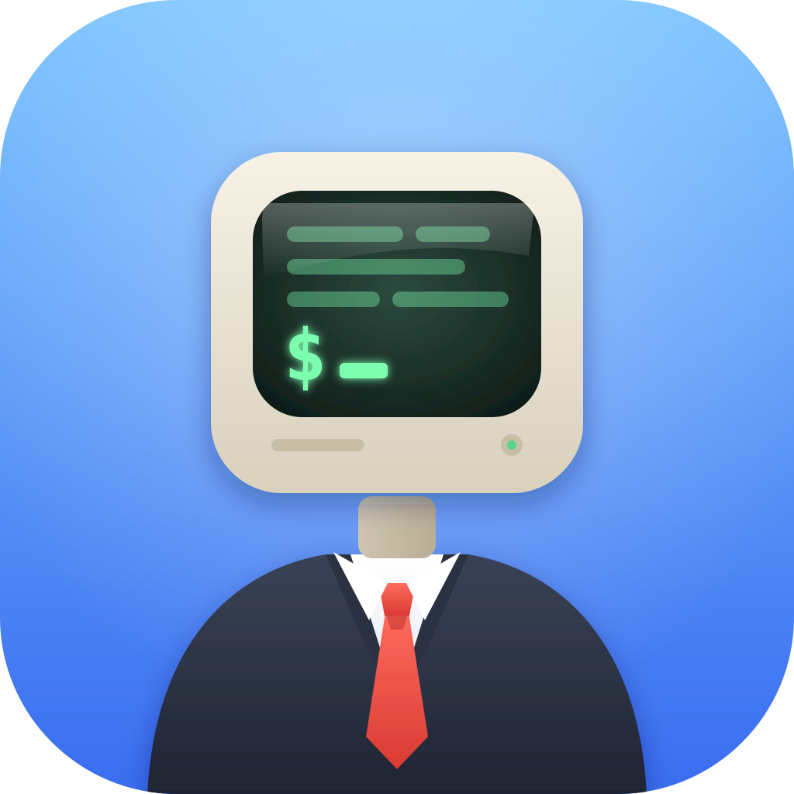

# divide-et-impera: Claude Code plugin for multi-agent model routing by criticality

<p align="center">
  
</p>

<p align="center">
  <a href="LICENSE"></a>
  
  <a href="https://github.com/AtaJudge/divide-et-impera/actions/workflows/validate.yml"></a>
  
</p>

**divide-et-impera** is a Claude Code plugin and skill built to cut the cost of large tasks without lowering the bar on the code that matters. Your session model acts as the **orchestrator**: it decides which parts of a task are critical and writes those itself, while cheaper **subagents** pinned to Haiku and Sonnet handle the reading, searching and routine code. It is multi-agent cost optimization for Claude Code, driven by an explicit criticality test instead of guesswork.

```
/plugin install divide-et-impera --marketplace AtaJudge/divide-et-impera
```

## What it is

A Claude Code plugin with three parts:

| Part | Model | Does |
|---|---|---|
| **Orchestrator** | Your session model | Plans, decides what is critical, writes the critical work itself, verifies, reports |
| **`dei-builder`** | Sonnet | Substantial non-critical work: features built to a spec, tests, docs, refactors |
| **`dei-scout`** | Haiku | Simple, isolated work: web and codebase search, collecting sources, parsing, small scripts |
| **`dei-deputy`** (optional) | Opus | Runs one large workstream, delegating to scouts and builders |

The orchestrator checks critical claims against primary sources (the actual doc, file or test output). Its final report lists what was **verified**, what was **corrected**, and what is still **open**.

## Why it saves money without losing quality

Most tokens in a long task go to reading, searching and routine code. Those can run on models that cost **1/80 (Haiku)** or **1/4 (Sonnet)** of Fable per token. The code where a mistake is expensive stays with the strongest model.

Prices per 1M tokens, input / output:

| Model | Price |
|---|---|
| Haiku 5.5 | $0.10 / $0.50 |
| Sonnet 5.5 | $2 / $10 |
| Opus 5.5 | $4 / $20 |
| Fable 5.2 | $8 / $40 |

## How it decides what is critical

Work counts as critical if **any** of these is yes. The test judges the impact of a change, not its size.

1. **Irreversible:** is a mistake hard or impossible to undo?
2. **Security boundary:** does it touch authn/authz, secrets, crypto or untrusted input?
3. **Blast radius:** would a mistake hit many users or systems?
4. **Silent failure:** could it be wrong without anyone noticing at first?
5. **Foundation:** will other work be built on it?
6. **Untestable here:** can it not be verified automatically in this environment?

When in doubt, it counts as critical. Projects can add their own critical areas in `CLAUDE.md` under the heading `Critical in this project`; [`examples/CLAUDE.md`](examples/CLAUDE.md) shows the format.

## Modes by orchestrator model

- **Fable or Opus orchestrator:** writes the critical code itself.
- **Sonnet or Haiku orchestrator:** hands critical code to an Opus subagent with a full spec, then reviews it.
- **Fable `four-eyes`:** applies the four-eyes principle, also called dual control. The model that writes critical code is never the model that approves it:
  - Fable writes the spec and reviews the code. It writes no code itself.
  - Opus writes every line of the critical code, and makes every fix Fable asks for.
  - The result is an independent check on your most dangerous code. In testing, the implementer even found a security gap in Fable's own spec.
  - It costs more than the default: about 30% more on the test task. It is a mode for assurance, not for saving money.
  - It works only with a Fable orchestrator; other models ignore it.

## Use cases

- **Auth or billing features** surrounded by lots of routine code: the trust boundary stays with the orchestrator, the CRUD and UI go to builders.
- **Database migrations** plus the application changes around them.
- **Research, then build:** scouts compare libraries and read docs, then builders implement against a spec.
- **Large refactors with a risky core:** the core interface is written by the orchestrator; the mechanical follow-through is delegated.
- **Firmware or infrastructure config** next to documentation and tooling.
- **Security fixes,** where the fix is critical but the tests and write-up are not.
- **Codebase audits** followed by targeted fixes.
- **Multi-module work in parallel tracks,** with an optional deputy per workstream.

**When not to use it:** small or single-step tasks, where delegation overhead outweighs the savings.

## Test results

Each scenario ran once, headless; costs are single-run figures. The four-eyes runs were recorded while the mode was still called `balanced`; its behavior has not changed since.

**Standard task:** a word-frequency CLI with tests (non-critical), a Python docs lookup (simple), and a function that deletes old files (critical: irreversible, and a security boundary).

| Scenario | Critical part done by | Other parts | Generated tests | Cost |
|---|---|---|---|---|
| Opus 5.5 orchestrator | Opus itself | Sonnet builder, Haiku scout | 22/22 pass | $0.59 |
| Fable 5.2 orchestrator | Fable itself | Sonnet builder, Haiku scout | 33/33 pass | $1.28 |
| Fable 5.2, four-eyes | Opus wrote it; Fable reviewed it and wrote no code | Sonnet builder, Haiku scout | 33/33 pass | $1.66 |
| Sonnet 5.5 orchestrator | Escalated to an Opus subagent | Sonnet builder, Haiku scout | 29/29 pass | $0.58 |
| Haiku 5.5 orchestrator | Escalated to an Opus subagent | Sonnet builder | 30/30 pass | $0.41 |
| Opus with `four-eyes` requested | Opus itself; it said four-eyes is Fable-only | Sonnet builder, Haiku scout | 23/23 pass | $0.57 |

**Other scenarios:**

| Scenario | What happened | Tests | Cost |
|---|---|---|---|
| Manual install (short agent names) | Behaves the same as the plugin install | 24/24 | $0.64 |
| Skill installed without its agents | Told the user the agents were missing; did not silently fall back to the expensive built-in agents | 23/23 | $0.48 |
| Project marks the CLI as critical in `CLAUDE.md` | The orchestrator wrote the CLI itself | 25/25 | $0.62 |
| One-line edit | Started no subagents | – | $0.18 |
| Large task in two workstreams (7 doc lookups, 5 modules, Fable) | One scout and two builders; no deputy, because it was not worth it | 42/42 | $1.36 |
| Fable four-eyes review loop, with a gap planted in the first spec | Gap caught in review and fixed in a second round by the same Opus worker; Fable wrote no code | 20/20 | $1.24 |
| Deputy layer with `CLAUDE_CODE_MAX_SUBAGENT_SPAWN_DEPTH=2` | Orchestrator → Opus deputy → two Sonnet builders | 39/39 | $0.84 |
| Deputy requested where nesting is off | Deputy reported it could not start workers; the orchestrator started five builders itself and told the user how to turn nesting on | 35/35 | $0.90 |

**Observed in every run:**
- each part went to the intended tier;
- workers ran on their pinned models;
- no worker went outside its brief or worked around a denied command;
- a docs page that could not be loaded was marked unverified, not presented as fact.

> **Highlight: four eyes caught what two missed.** In a four-eyes run, the Opus implementer found a security gap in Fable's own spec: a trailing slash let a symlinked directory slip past the check. It reported the gap instead of quietly working around it, and the gap was fixed before the code was accepted. In a second run, a gap planted on purpose was caught in review and fixed by the implementer in a second round.

## How it compares to other approaches

| | Single model does everything | Per-prompt model router | Generic subagent collection | **divide-et-impera** |
|---|---|---|---|---|
| Cost on reading, search, routine code | Top-tier price for every token | Lower, if the prompt is routed down | Depends on each agent's model | Haiku / Sonnet prices |
| Granularity of routing | None | Whole prompt | Per agent, chosen by you | Per part of a task |
| What decides the tier | – | Prompt classifier | Agent descriptions | Six-axis criticality test, plus project rules |
| Who writes critical code | The one model | Whichever model the prompt went to | Whichever agent was picked | The orchestrator (or Opus, under a weaker orchestrator) |
| Verification of worker output | – | – | Varies | Critical claims checked against primary sources; corrections reported |
| Model per worker | – | Chosen at runtime | Can inherit the parent's model if not set | Pinned in the agent definitions |

A single strong model is the simplest choice and the right one for small tasks. This plugin is for the large ones.

## Where it works

| Where | Works? | Notes |
|---|---|---|
| Claude Code: terminal, IDE extensions, and the **Code** tab of the Claude desktop app | Yes, fully | Tested |
| **Cowork** in the Claude desktop app | Should work | Cowork loads plugin skills and agents. Not tested yet |
| Regular **chat** on claude.ai or in the desktop app | No | Chat ignores agents, so there are no workers to delegate to, and it has no slash commands to start the skill. Use the **Code** tab instead |

## Installation

### Claude desktop app or claude.ai (no terminal needed)

1. Open **Customize > Plugins** ([claude.ai/customize/plugins](https://claude.ai/customize/plugins)).
2. Add a marketplace from GitHub: `AtaJudge/divide-et-impera`.
3. Install **divide-et-impera** from it.

A plugin you install this way is tied to your claude.ai account. It also syncs to Claude Code when you start a session signed in with the same account.

To use it, open the **Code** tab of the desktop app, pick a folder, and type `/divide-et-impera:divide-et-impera <task>`. It does not run in regular chat.

### Claude Code (terminal)

You need Claude Code itself first. If `claude --version` says "command not found", install it:

```bash
curl -fsSL https://claude.ai/install.sh | bash
```

Open a new terminal, run `claude` and sign in. Then continue below.

**Plugin, Claude Code 2.1.275 or later:**

```
/plugin install divide-et-impera --marketplace AtaJudge/divide-et-impera
```

**Older versions:** add the marketplace, then install.

```
/plugin marketplace add AtaJudge/divide-et-impera
/plugin install divide-et-impera@divide-et-impera
```

**Manual install** (all projects):

```bash
git clone https://github.com/AtaJudge/divide-et-impera.git
mkdir -p ~/.claude/skills ~/.claude/agents
cp -r divide-et-impera/skills/divide-et-impera ~/.claude/skills/
cp divide-et-impera/agents/*.md ~/.claude/agents/
```

For a single project, copy into `.claude/skills/` and `.claude/agents/` instead. Use this for cloud sessions.

**Optional, deputy layer:** add `"CLAUDE_CODE_MAX_SUBAGENT_SPAWN_DEPTH": "2"` to the `env` block of your settings.

## Usage

| Install | Command |
|---|---|
| Plugin | `/divide-et-impera:divide-et-impera <task>` |
| Plugin, Fable session, four-eyes mode | `/divide-et-impera:divide-et-impera four-eyes <task>` |
| Manual | `/divide-et-impera <task>` (or `/divide-et-impera four-eyes <task>`) |

It only runs when you invoke it, on purpose (`disable-model-invocation: true`), so it never starts subagents you did not ask for.

## FAQ

**What is divide-et-impera?**
A Claude Code plugin that splits a large task across models by criticality. The session model orchestrates and writes critical work; a Sonnet builder and a Haiku scout do the rest.

**How much does it save?**
It depends on how much of the task is reading, searching and routine code. Those tokens run at 1/80 (Haiku) or 1/4 (Sonnet) of Fable's per-token price. See the [test results](#test-results) for single-run costs.

**Does it lower code quality?**
Critical work stays with the orchestrator, or goes to Opus under a Sonnet or Haiku orchestrator. When in doubt, work is treated as critical. Critical claims are checked against primary sources, and corrections are reported to you.

**Which orchestrator model should I use?**
Fable or Opus write critical code themselves. Sonnet and Haiku escalate it to an Opus subagent and review it. `four-eyes` mode is for Fable only.

**When should I use four-eyes mode?**
Use it for code where a mistake is expensive and you want separation of duties: auth, payments, migrations, deletion logic, firmware or infrastructure changes. Fable specifies and approves, and Opus implements. Expect it to cost more than the default mode.

**Will it start subagents on its own?**
No. The skill runs only when you invoke it. A one-line edit in testing started no subagents.

**How do I check which model each subagent runs on?**
Run `/tasks`. A subagent with no explicit model inherits its parent's model, which is why the skill only uses its own agents, whose models are pinned.

**Can I mark parts of my project as always critical?**
Yes. Add a `Critical in this project` section to your `CLAUDE.md`. See [`examples/CLAUDE.md`](examples/CLAUDE.md).

**What if the agents are not installed?**
The skill tells you, and does not silently fall back to the built-in agents.

## Notes

- Plugin installs prefix agent names with `divide-et-impera:` (for example `divide-et-impera:dei-scout`); the skill handles both forms.
- A subagent with no explicit model inherits its parent's model, which is why the skill only uses its own pinned agents. Check with `/tasks`.
- `dei-scout` has Bash for small scripts and is told to stay read-only; for a hard limit, add `permissions.deny` rules.
- The plugin is versioned (1.0.0); updates come through `claude plugin update` or the `/plugin` menu.

## Contributing

Issues and pull requests are welcome; see [CONTRIBUTING.md](CONTRIBUTING.md). Report security issues privately; see [SECURITY.md](SECURITY.md).

## License

MIT. See [LICENSE](LICENSE).
